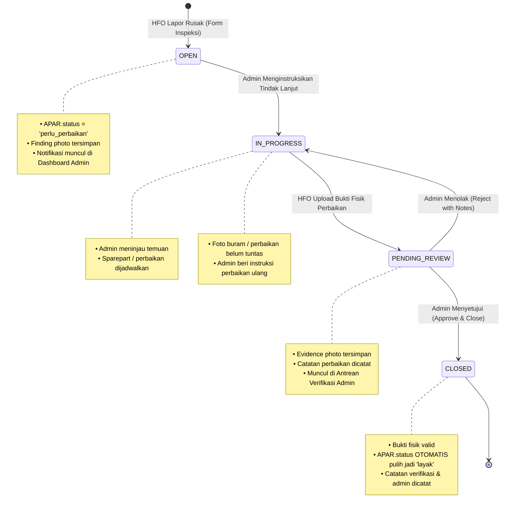

# Architecture Specification Document — Modul Admin Pusat
## Sistem Tracking & Inspeksi APAR Armada Rig (`apar-inspection-app`)

**Versi:** 1.0 (Arsitektur Sistem & Spesifikasi Komponen)  
**Target Platform:** Single Page Application (Vite + React 18 + Tailwind CSS + Lucide Icons)  
**Dokumen Terkait:** [docs/prd_admin.md](file:///c:/Users/ASUS/apar-inspection-app/docs/prd_admin.md), [docs/design_admin.md](file:///c:/Users/ASUS/apar-inspection-app/docs/design_admin.md)  
**Paradigma:** Local-First Reactive Store, Component-Driven Modular UI, Strict RBAC  

---

## 1. Ringkasan Arsitektur Sistem

Modul Admin Pusat dibangun di atas fondasi aplikasi yang sama dengan Modul User (HFO), memanfaatkan **Local-First Reactive State Engine** melalui React Context API (`AparContext.jsx`) dan persistensi `localStorage`. Hal ini memungkinkan aplikasi beroperasi secepat kilat (*zero latency*), dapat di-deploy ke hosting statis manapun (seperti Vercel atau intranet lokal rig), dan memiliki sinkronisasi data instan antara input HFO di lapangan dengan layar pengawasan Admin di kantor pusat.

```
┌─────────────────────────────────────────────────────────────────────────────────┐
│                          REACT APPLICATION SHELL                                │
│                             (src/App.jsx)                                       │
├─────────────────────────────────────────────────────────────────────────────────┤
│                             APAR CONTEXT PROVIDER                               │
│                    (src/shared/context/AparContext.jsx)                         │
│   • Reactive State: Users, Rigs, APARs (224), Inspections (224), Maintenances (8)│
│   • Action Dispatchers: submitInspection, approveTicket, rejectTicket, CRUD APAR │
├────────────────────────────────────────┬────────────────────────────────────────┤
│           MODUL USER / HFO             │           MODUL ADMIN PUSAT            │
│         (Scope: 1 Rig Aktif)           │       (Scope: Global 16 Rig Armada)    │
│            (src/user/*)                │               (src/admin/*)            │
├────────────────────────────────────────┼────────────────────────────────────────┤
│ • Mobile-First Touch Layout            │ • Desktop-First Command Center Layout  │
│ • Single-Rig Filtered Views            │ • Fleet Telemetry & 16 Rig Matrix      │
│ • QR Scanner & Inspect Form            │ • Side-by-Side Verification Drawer     │
│ • Upload Repair Evidence               │ • Bulk QR Sheet Sticker Generator      │
│ • HFO Profile & Password Change        │ • Excel BMS 2025 Standard CSV Exporter │
└────────────────────────────────────────┴────────────────────────────────────────┘
                                    │
                                    ▼
┌─────────────────────────────────────────────────────────────────────────────────┐
│                         LOCAL STORAGE PERSISTENCE ENGINE                        │
│   bms_apar_v1_user  │  bms_apar_v1_users  │  bms_apar_v1_apars                  │
│   bms_apar_v1_inspections                 │  bms_apar_v1_maintenances           │
└─────────────────────────────────────────────────────────────────────────────────┘
```

---

## 2. Struktur Direktori & File Modul Admin

Struktur kode diatur dengan pemisahan domain yang bersih antara modul user, modul admin, dan komponen bersama (*shared*):

```
apar-inspection-app/
├── docs/
│   ├── prd_admin.md                    # Dokumen Kebutuhan Produk Admin
│   ├── design_admin.md                 # Spesifikasi UI/UX & Token Desain
│   └── architecture_admin.md           # Spesifikasi Arsitektur Sistem (Dokumen ini)
├── src/
│   ├── admin/                          # [DOMAIN MODUL ADMIN PUSAT]
│   │   ├── components/
│   │   │   ├── AdminLayout.jsx         # Shell desktop admin: Sidebar + TopNav + Outlet
│   │   │   ├── AdminSidebar.jsx        # Sidebar navigasi vertikal (badge status & counters)
│   │   │   ├── AdminTopNav.jsx         # Topbar: Global search, Rig switcher, Profile
│   │   │   ├── SideBySideReviewDrawer.jsx # Drawer verifikasi foto sebelum/sesudah perbaikan
│   │   │   ├── BulkQrPrintModal.jsx    # Generator cetak stiker QR Code lembar A4
│   │   │   └── AparFormModal.jsx       # Modal dialog Tambah / Edit master APAR
│   │   └── pages/
│   │       ├── AdminDashboard.jsx      # Fleet Telemetry & Rig Compliance Matrix (16 Rig)
│   │       ├── AdminAparList.jsx       # Master data APAR armada & pencarian multi-filter
│   │       ├── AdminMaintenances.jsx   # Manajemen work order & verifikasi tiket kerusakan
│   │       ├── AdminInspections.jsx    # Log audit inspeksi global seluruh personel HFO
│   │       ├── AdminHydrotest.jsx      # Radar siklus uji tekan 5 tahunan & SPK vendor
│   │       ├── AdminUsers.jsx          # Direktori 48 HFO, reset password, rotasi rig
│   │       └── AdminReports.jsx        # Generator & ekspor laporan standar Excel BMS 2025
│   ├── shared/                         # [MODUL BERSAMA / CORE KERNEL]
│   │   ├── components/
│   │   │   └── ProtectedRoute.jsx      # Guard rute berdasarkan peran (User vs Admin)
│   │   ├── context/
│   │   │   └── AparContext.jsx         # Single source of truth, state machine, dispatchers
│   │   ├── data/                       # Seed data awal realistis
│   │   │   ├── aparsSeed.js            # 224 Unit APAR di 16 Rig operasional
│   │   │   ├── aparTypesSeed.js        # 7 Tipe standar APAR (termasuk CO2 flag)
│   │   │   ├── hfoUsersSeed.js         # 48 Akun HFO (3 HFO per Rig)
│   │   │   ├── inspectionsSeed.js      # 224 Log inspeksi bulan lalu & bulan ini
│   │   │   ├── maintenancesSeed.js     # 8 Tiket perbaikan aktif & historis
│   │   │   └── rigsSeed.js             # 16 Rig BMS (BMS-02 s.d. BMS-21)
│   │   ├── pages/
│   │   │   └── LoginPage.jsx           # Portal login terpadu (Tab User HFO & Tab Admin)
│   │   └── utils/
│   │       ├── swalHelper.js           # SweetAlert2 wrapper responsif & tema HSE K3
│   │       └── excelExportHelper.js    # Utility ekspor CSV format BMS Tracking APAR 2025
│   ├── user/                           # [DOMAIN MODUL USER / HFO LAPANGAN]
│   └── App.jsx                         # Router rute aplikasi
```

---

## 3. Kontrak Data & Skema Entitas (Data Contracts)

### 3.1 Skema Master APAR (`Apar`)
```typescript
interface Apar {
  id: string;                    // Format: "apar-bms07-001"
  rigId: string;                 // Foreign Key: "BMS-07"
  typeId: string;                // Foreign Key: "type-powder-9kg" | "type-co2-68kg"
  assetCode: string;             // Display Code: "APAR-BMS07-001"
  brand: string;                 // Merek: "Firex FX-90", "Tonata", "Champion"
  serialNo: string;              // Nomor Seri Tabung Fisik: "FX-90211"
  capacity: string;              // "9 Kg", "6.8 Kg", "100 Liter"
  location: string;              // Penempatan: "Rig Carrier", "Mud Pump", "Genset"
  chargeOwner: "BMS" | "APM";    // Beban biaya pengisian ulang
  manufactureDate: string;       // Tanggal Pembuatan / Uji Terakhir: "YYYY-MM-DD"
  hasPressureGauge: boolean;     // False untuk CO2, True untuk Powder/Foam
  status: "layak" | "perlu_perbaikan"; // Status operasional fisik
  lastInspectionDate: string;    // Tanggal inspeksi terakhir: "YYYY-MM-DD"
  lastInspectionStatus: "layak" | "tidak_layak";
  lastInspectedBy: string;       // Nama HFO pengecek: "APRIADI S"
}
```

### 3.2 Skema Log Inspeksi Fisik 7 Titik (`Inspection`)
```typescript
interface Inspection {
  id: string;                    // Format: "insp-17112026-001"
  aparId: string;                // Foreign Key ke Apar.id
  assetCode: string;             // "APAR-BMS07-001"
  rigId: string;                 // "BMS-07"
  inspectorName: string;         // Nama HFO: "APRIADI S"
  inspectionDate: string;        // "YYYY-MM-DD"
  category: "bulanan" | "tahunan"; // "bulanan" (Kru Rig) | "tahunan" (Vendor)
  thirdPartyVendor?: string;     // Misal: "PT Sepakat" jika category === "tahunan"
  checklist: {
    handle: "bagus" | "rusak";
    hose: "bagus" | "rusak";
    nozle: "bagus" | "rusak";
    pengamanTabung: "bagus" | "rusak";
    pinSegel: "bagus" | "rusak";
    pressureGauge: "bagus" | "rusak" | "na"; // 'na' WAJIB jika CO2 (Poka-Yoke)
    tabung: "bagus" | "rusak";
  };
  overallStatus: "layak" | "tidak_layak";
  issueDescription?: string;     // Wajib diisi jika overallStatus === "tidak_layak"
  findingPhoto?: string | null;  // Base64 compressed image (< 300KB)
  createdAt: string;             // ISO Timestamp
}
```

### 3.3 Skema Tiket Perbaikan Work Order (`MaintenanceTicket`)
```typescript
interface MaintenanceTicket {
  id: string;                    // Format: "mnt-17112026-001"
  aparId: string;                // Foreign Key ke Apar.id
  assetCode: string;             // "APAR-BMS07-003"
  rigId: string;                 // "BMS-07"
  inspectorName: string;         // Nama pelapor awal
  reportedBy: string;            // Nama HFO pelapor kerusakan
  reportedDate: string;          // "YYYY-MM-DD"
  issueDescription: string;      // Rincian kerusakan: "Selang retak, pin segel putus"
  findingPhoto: string | null;   // Foto bukti awal kerusakan dari HFO
  status: "open" | "in_progress" | "pending_review" | "closed";
  repairNotes?: string;          // Catatan tindakan perbaikan dari HFO
  evidencePhoto?: string | null; // Foto bukti fisik selesai perbaikan dari HFO
  evidenceUploadedBy?: string;   // Nama HFO yang mengunggah bukti selesai
  verifiedBy?: string;           // Nama Admin yang memverifikasi penutupan tiket
  verifiedDate?: string;         // Tanggal tiket disetujui & ditutup
  adminFeedback?: string;        // Catatan revisi jika bukti ditolak oleh Admin
  updatedAt: string;             // Tanggal pembaruan terakhir
}
```

---

## 4. Mesin Status & State Machine Tiket Perbaikan

Diagram berikut mengilustrasikan siklus hidup tiket perbaikan dan titik interaksi krusial antara Modul User (HFO) dan Modul Admin:



---

## 5. Ekstensi Action Dispatcher pada `AparContext.jsx`

Untuk mendukung kapabilitas Admin, `AparContext.jsx` diekstensi dengan fungsi-fungsi terpadu:

### 5.1 Selektor Terkomputasi Global (Global Computed Selectors)
```javascript
// 1. Telemetri Kepatuhan Armada (16 Rig)
const fleetTelemetry = useMemo(() => {
  const totalApars = apars.length; // 224 unit
  const inspectedThisMonth = apars.filter(a => isCheckedThisMonth(a.lastInspectionDate)).length;
  const damagedApars = apars.filter(a => a.status === 'perlu_perbaikan').length;
  const pendingReviewTickets = maintenances.filter(m => m.status === 'pending_review').length;
  const expiredHydrotest = apars.filter(a => getHydrotestStatus(a.manufactureDate) === 'kadaluarsa').length;

  return {
    totalApars,
    inspectedThisMonth,
    inspectionCompliancePct: totalApars > 0 ? Math.round((inspectedThisMonth / totalApars) * 100) : 0,
    damagedApars,
    pendingReviewTickets,
    expiredHydrotest,
    actionRequiredCount: damagedApars + expiredHydrotest
  };
}, [apars, maintenances]);

// 2. Matriks Status 16 Rig
const rigComplianceMatrix = useMemo(() => {
  return rigs.map(rig => {
    const rigApars = apars.filter(a => a.rigId === rig.id);
    const inspected = rigApars.filter(a => isCheckedThisMonth(a.lastInspectionDate)).length;
    const damaged = rigApars.filter(a => a.status === 'perlu_perbaikan').length;
    const pendingTickets = maintenances.filter(m => m.rigId === rig.id && m.status === 'pending_review').length;
    
    return {
      rigId: rig.id,
      rigName: rig.name,
      totalApar: rigApars.length,
      inspectedCount: inspected,
      compliancePct: rigApars.length > 0 ? Math.round((inspected / rigApars.length) * 100) : 0,
      damagedCount: damaged,
      pendingTickets
    };
  });
}, [rigs, apars, maintenances]);
```

### 5.2 Aksi Verifikasi Work Order Admin
```javascript
/**
 * Admin menyetujui bukti perbaikan dan menutup tiket
 * Dampak otomatis: status tabung APAR kembali 'layak'
 */
const approveMaintenanceTicket = (maintenanceId, adminNotes = '') => {
  const adminName = currentUser?.name || 'Admin HSE Pusat';
  const today = new Date().toISOString().split('T')[0];

  const targetMnt = maintenances.find(m => m.id === maintenanceId);
  if (!targetMnt) throw new Error('Tiket tidak ditemukan.');

  // 1. Ubah tiket menjadi closed
  setMaintenances(prev => prev.map(m => m.id === maintenanceId ? {
    ...m,
    status: 'closed',
    verifiedBy: adminName,
    verifiedDate: today,
    adminFeedback: adminNotes,
    updatedAt: today
  } : m));

  // 2. Pulihkan status APAR terkait menjadi 'layak'
  setApars(prev => prev.map(a => a.id === targetMnt.aparId ? {
    ...a,
    status: 'layak',
    lastInspectionStatus: 'layak'
  } : a));

  return true;
};

/**
 * Admin menolak bukti perbaikan dan meminta perbaikan ulang
 */
const rejectMaintenanceTicket = (maintenanceId, rejectionReason) => {
  if (!rejectionReason || rejectionReason.trim().length === 0) {
    throw new Error('Alasan penolakan wajib diisi untuk panduan HFO.');
  }

  const today = new Date().toISOString().split('T')[0];
  setMaintenances(prev => prev.map(m => m.id === maintenanceId ? {
    ...m,
    status: 'in_progress',
    adminFeedback: rejectionReason,
    updatedAt: today
  } : m));

  return true;
};
```

### 5.3 Aksi CRUD Master Data APAR
```javascript
/**
 * Tambah Tabung APAR Baru ke Armada
 */
const createApar = (newAparData) => {
  const id = `apar-${newAparData.rigId.toLowerCase().replace(/[^a-z0-9]/g, '')}-${Date.now().toString().slice(-4)}`;
  const aparRecord = {
    id,
    ...newAparData,
    status: 'layak',
    lastInspectionDate: null,
    lastInspectionStatus: 'layak',
    lastInspectedBy: null
  };

  setApars(prev => [aparRecord, ...prev]);
  return aparRecord;
};

/**
 * Update Data Tabung APAR
 */
const updateApar = (aparId, updatedFields) => {
  setApars(prev => prev.map(a => a.id === aparId ? { ...a, ...updatedFields } : a));
  return true;
};

/**
 * Hapus Tabung APAR dari Armada
 */
const deleteApar = (aparId) => {
  setApars(prev => prev.filter(a => a.id !== aparId));
  // Bersihkan juga tiket terkait
  setMaintenances(prev => prev.filter(m => m.aparId !== aparId));
  return true;
};
```

### 5.4 Aksi Pengelolaan Personel HFO
```javascript
/**
 * Reset Password HFO ke Standar '123456'
 */
const resetHfoPassword = (userId) => {
  setUsers(prev => prev.map(u => u.id === userId ? { ...u, password: '123456' } : u));
  return true;
};

/**
 * Mutasi / Rotasi Rig HFO
 */
const reassignHfoRig = (userId, newRigId) => {
  setUsers(prev => prev.map(u => u.id === userId ? { ...u, rigId: newRigId } : u));
  return true;
};
```

---

## 6. Konfigurasi Rute & Guard Autentikasi (`App.jsx`)

Struktur rute dalam `src/App.jsx` mengamankan Modul Admin menggunakan `ProtectedRoute` dengan verifikasi peran `admin`:

```jsx
// src/App.jsx Rute Admin Terintegrasi
<Route
  path="/admin"
  element={
    <ProtectedRoute allowedRole="admin">
      <AdminLayout />
    </ProtectedRoute>
  }
>
  <Route index element={<Navigate to="/admin/dashboard" replace />} />
  <Route path="dashboard" element={<AdminDashboard />} />
  <Route path="apars" element={<AdminAparList />} />
  <Route path="maintenances" element={<AdminMaintenances />} />
  <Route path="inspections" element={<AdminInspections />} />
  <Route path="hydrotest" element={<AdminHydrotest />} />
  <Route path="users" element={<AdminUsers />} />
  <Route path="reports" element={<AdminReports />} />
</Route>
```

---

## 7. Generator Laporan Excel Standar BMS (`excelExportHelper.js`)

Untuk memastikan ekspor laporan bulanan dapat langsung dibuka di Microsoft Excel tanpa masalah teks rusak atau format berantakan:

1. **Header BOM UTF-8:** Karakter `\uFEFF` disematkan di awal string CSV agar Excel otomatis mendeteksi encoding UTF-8 (mencegah karakter tanda hubung, titik, dan teks Indonesia rusak).
2. **Pemetaan 19 Kolom Identik dengan `Tracking_APAR_2025.xlsx`:**
   - `No`
   - `Rig`
   - `Tanggal`
   - `Type`
   - `Serial No`
   - `Tahun APAR`
   - `Penempatan`
   - `Handle` (OK / Rusak)
   - `Hose` (OK / Rusak)
   - `Nozle` (OK / Rusak)
   - `Pengaman Tabung` (OK / Rusak)
   - `Pin Handle` (OK / Rusak)
   - `Pressure Gauge` (OK / Rusak / N/A)
   - `Tabung` (OK / Rusak)
   - `Tindakan` (Layak / Perlu Perbaikan)
   - `Charge` (BMS / APM)
   - `Pihak ke 3` (Nama Vendor)
   - `Inspeksi Tahunan` (Ya / Tidak)
   - `Hydrotest APAR` (Aman / Segera / Kadaluarsa)
   - `Hal Perbaikan` (Deskripsi temuan / catatan)
3. **Download Trigger:** Dijalankan via `URL.createObjectURL(blob)` dengan penamaan dinamis: `Laporan_Inspeksi_APAR_BMS_[PERIODE].csv`.

---

## 8. Arsitektur Cetak Stiker QR Code Massal (`BulkQrPrintModal.jsx`)

Stiker QR fisik dicetak menggunakan styling khusus `@media print`:

1. **Komponen QR Engine:** Memanfaatkan pustaka `qrcode.react` (`QRCodeSVG`).
2. **Spesifikasi CSS Cetak:**
   ```css
   @media print {
     body * { visibility: hidden; }
     #bulk-qr-sheet, #bulk-qr-sheet * { visibility: visible; }
     #bulk-qr-sheet {
       position: absolute;
       left: 0;
       top: 0;
       width: 210mm; /* Lebar Lembar A4 */
       display: grid;
       grid-template-columns: repeat(3, 1fr);
       gap: 4mm;
       padding: 8mm;
     }
     .qr-sticker-card {
       page-break-inside: avoid;
       border: 1px dashed #94A3B8;
       border-radius: 4px;
       padding: 3mm;
     }
   }
   ```
3. **Payload QR Code:** Menyimpan string URL routing: `${window.location.origin}/user/inspect/${apar.id}` sehingga ketika HFO memindai stiker dengan kamera ponsel, aplikasi langsung membuka form inspeksi tabung tersebut.

---

## 9. Keandalan, Kapasitas & Integritas Data

1. **Efisiensi Penyimpanan LocalStorage:**
   - 224 Tabung APAR + 224 Log Inspeksi + 48 Akun HFO + 8 Tiket memakan sekitar **~380 KB**.
   - Batas browser LocalStorage adalah **5.000 KB (5 MB)**, sehingga menyisakan lebih dari **90% ruang kosong**.
2. **Kompresi Gambar Berbasis Canvas:**
   - Setiap foto kerusakan atau foto bukti perbaikan yang diunggah HFO dikompresi otomatis via HTML5 Canvas ke ukuran `< 300 KB` (resolusi maks 1024px, JPEG quality 0.7) sebelum disimpan ke state, menjamin LocalStorage tidak pernah mengalami *QuotaExceededError*.
3. **Penyelarasan Poka-Yoke CO2:**
   - Validasi level komponen dan level store secara tegas mengunci `pressureGauge = 'na'` untuk tabung CO2 (`hasPressureGauge === false`), mencegah kesalahan manusia di lapangan yang mencoba mencatat manometer pada tabung yang tidak memilikinya.

---

## 10. Kesimpulan & Kesiapan Eksekusi

Arsitektur Modul Admin Pusat ini dirancang presisi, saling mengunci (*seamlessly coupled*) dengan Modul User HFO yang sudah aktif di `apar-inspection-app`, dan siap dikembangkan menjadi antarmuka produksi berstandar HSE industri minyak & gas. Dokumentasi ini menjadi acuan mutlak bagi tim pengembang dalam membangun komponen-komponen di `src/admin/`.